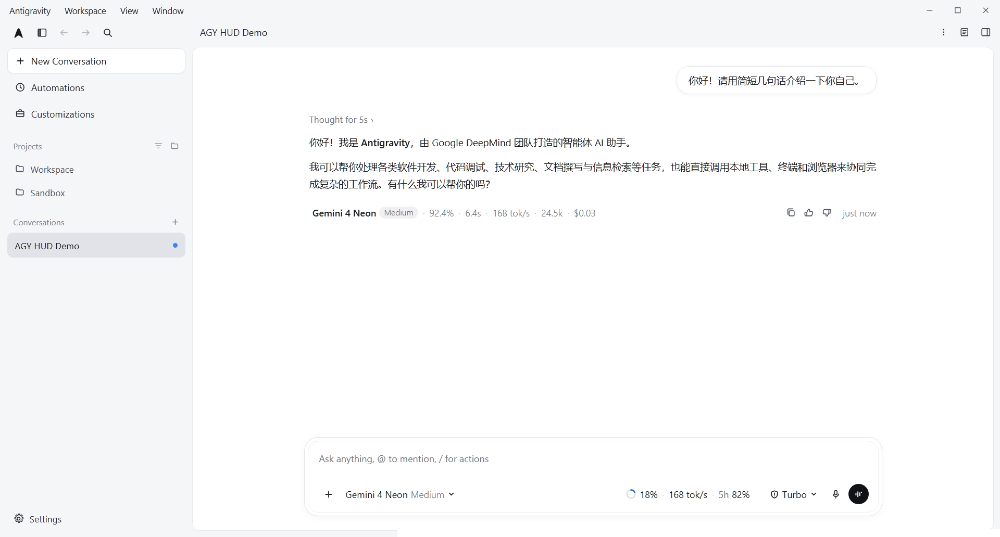
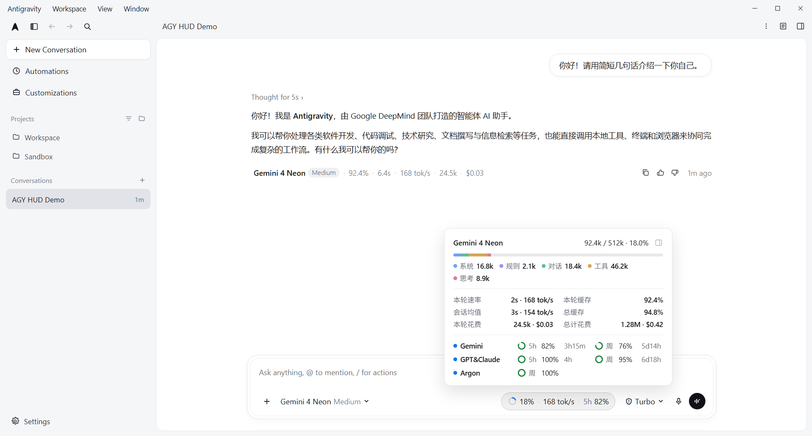
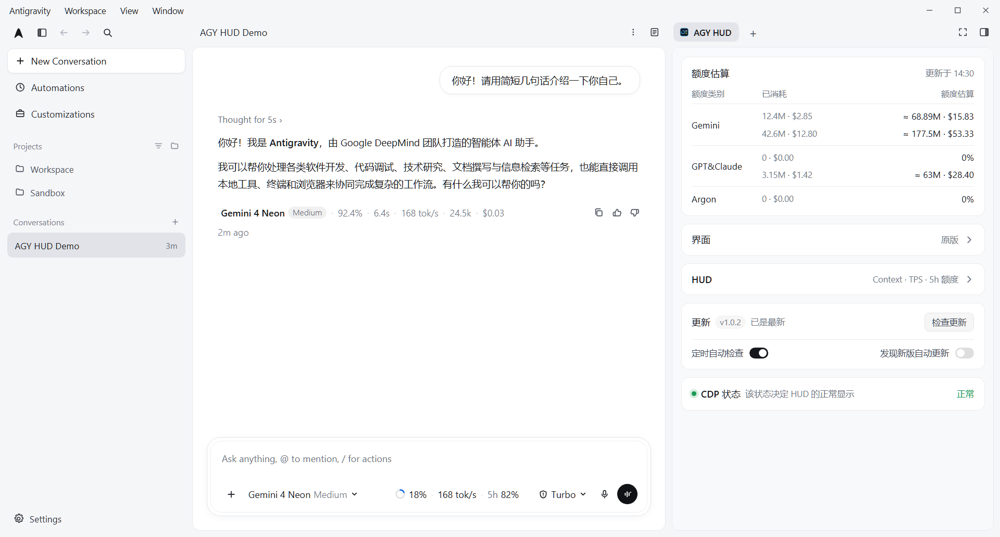

<div align="center">


# AGY HUD

**Antigravity 输入栏状态监控与界面增强插件**

在对话界面直接查看上下文占用、生成速度、缓存命中率、剩余额度与每轮消耗，同时支持排版间距调节与 5h / 周额度估算。

[](https://github.com/Wujuhu/antigravity-hud/releases/latest)
[](#安装)
[](#安装)
[](./LICENSE)

</div>

---

## 核心功能

- **输入框状态栏**：在输入框底部直接显示上下文占比、生成速度和 5h 剩余额度，支持自定义显示项和顺序，切换对话自动更新。
- **悬停详情卡**：鼠标移到状态栏上即可查看上下文各部分占比（含压缩次数）、缓存命中率、历史均速，以及各模型分组的 5h / 周剩余额度与重置时间。
- **每轮对话汇总**：在每条回复下方与复制、点赞按钮同一行，显示本轮使用的模型、缓存命中率、耗时、生成速度、Token 用量和折合费用。
- **排版间距调节**：提供舒适、原版、紧凑三档预设，也可以按个人习惯微调行间距、段间距和列表间距。
- **额度估算与自动更新**：打开右侧边栏即可按需独立估算各分组 5h 与周额度的消耗及总量，平时不占后台资源；支持自动检查并更新插件。
- **不改宿主文件，支持双端**：不修改 Antigravity 原始安装包和配置文件，无第三方依赖，支持 Windows 与 macOS。

---

## 界面预览

> 以下界面示意图使用脱敏 Mock 数据生成，展示各状态下的实际视觉样式。

### 输入栏 HUD 与每轮底部总信息栏


### 悬停 HUD 详情浮层


### 右侧 AGY HUD 设置边栏


---

## 安装

> 环境要求：仅需 Node.js `>= 22.5.0`（**无需 Git，无需 `npm install`**）。安装后插件运行在 Antigravity 官方插件目录中，下载的安装包解压运行后即可直接删除。

### 方式一：AI Agent 自动安装（推荐）

将下方指令发送给你的 AI Agent，它会自动下载安装包、完成部署并清理临时文件：

```text
请按 https://github.com/Wujuhu/antigravity-hud/blob/main/docs/AGENT_INSTALL.md 安装 AGY HUD。
```

### 方式二：手动下载 ZIP 安装（无需 Git）

1. 前往 [Releases 页面](https://github.com/Wujuhu/antigravity-hud/releases/latest) 下载最新的 `agy-hud-v*.zip` 并解压：
   - **Windows**：双击解压目录内的 `install.cmd`（或在终端运行 `node scripts/install.mjs`）。
   - **macOS / Linux**：在终端进入解压目录并运行：
     ```bash
     chmod +x install.sh && ./install.sh
     ```
2. 安装脚本会自动把插件复制到 `~/.gemini/config/plugins/agy-hud`，并生成当前系统的启动器：
   - **Windows**：桌面 `Antigravity (HUD).lnk` 快捷方式
   - **macOS**：`/Applications/Antigravity (HUD).app`，同时在桌面创建指向它的快捷方式
3. **安装完成后即可直接删除刚才下载的 ZIP 和解压文件夹**，不影响运行与后续自动更新。

### 启用生效

先**完整退出** Antigravity（Windows 退出右下角托盘 / macOS 按 `Cmd + Q`），再通过刚生成的启动器重新打开即可生效：
- **Windows**：双击桌面 `Antigravity (HUD).lnk` 快捷方式
- **macOS**：打开 `/Applications/Antigravity (HUD).app` 或桌面快捷方式

> **提示**：以后日常启动也请始终通过对应的启动器打开 Antigravity，才能使用输入栏 HUD、悬停详情、每轮总信息栏与界面排版等完整功能。

---

## 卸载

- **AI Agent 卸载（推荐，无需保留安装包）**：
  ```text
  请按 https://github.com/Wujuhu/antigravity-hud/blob/main/docs/AGENT_UNINSTALL.md 卸载 AGY HUD。
  ```
- **手动卸载**：
  - 删除插件目录 `~/.gemini/config/plugins/agy-hud` 即可停用并保留配置。
  - 如需彻底清除：一并删除 `~/.gemini/antigravity/plugin_data/agy-hud` 与生成的启动器（Windows 桌面 `Antigravity (HUD).lnk`；macOS `/Applications/Antigravity (HUD).app` 及桌面快捷方式）。
  - 若本地仍保留安装包目录，也可直接运行 `uninstall.cmd` / `./uninstall.sh`（彻底清理加 `--purge-data`）。

---

## 开发与开源致谢

```bash
npm test         # 运行离线单元测试
npm run preview  # 生成亮/暗主题离线预览页
```

本项目基于 MIT 协议开源，部分模块参考或改编自以下项目（详见 [THIRD_PARTY_NOTICES.md](./THIRD_PARTY_NOTICES.md)）：
- [ahmetdotsh/agy-context](https://github.com/ahmetdotsh/agy-context)（MIT）
- [ahmetdotsh/agy-usage](https://github.com/ahmetdotsh/agy-usage)（MIT）
- [aishadiaodeqishui/agy-monitor](https://github.com/aishadiaodeqishui/agy-monitor)（MIT）
- [nkjDSLcvanv/antigravity-codex-theme](https://github.com/nkjDSLcvanv/antigravity-codex-theme)（MIT）
- [WhiteBr1ck/agy-powertools](https://github.com/WhiteBr1ck/agy-powertools)（MIT）
