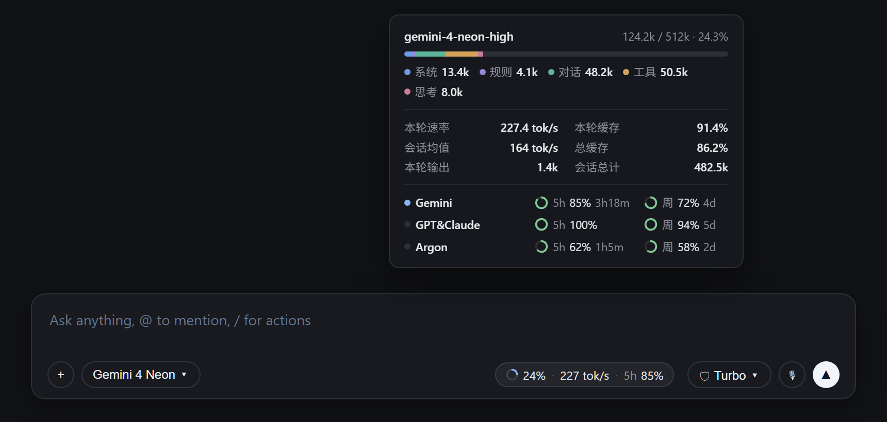
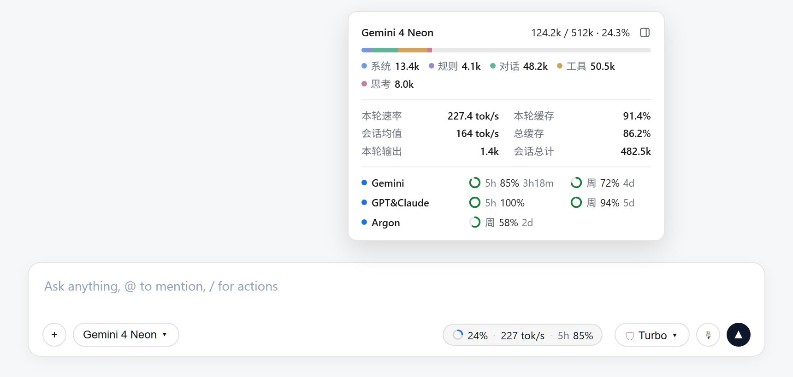
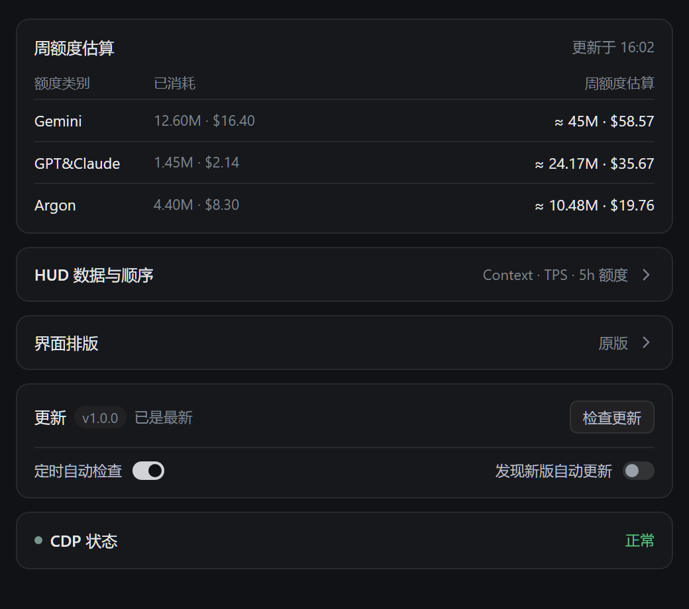

# AGY HUD

> 为 **Antigravity** 打造的跨平台极简输入栏遥测插件：在聊天输入框「权限选择器」左侧注入紧凑胶囊，鼠标悬停展开上下文构成、生成速率、本轮/总缓存命中率与账号全分组 5h/周额度；右侧边栏（Sidecar）提供自由拖拽排序、检查与自动更新、以及**仅在打开边栏时按需计算的周额度总 Token 与费用估算**。
>
> **统一跨平台框架（Node.js >= 22.5.0 + 标准 Web/CDP，零外部 npm 依赖）** · **不修改 `app.asar` 与 `config.json`** · **Windows（`.lnk`）& macOS（套壳 `.app`）双版本原生支持**

---

## 界面预览（已脱敏实景）

### 输入栏常驻胶囊 + Hover 详情浮层（自动适配深 / 浅主题）

| 深色主题 | 浅色主题 |
| :---: | :---: |
|  |  |

### 右侧辅助边栏（Sidecar）：拖拽排序 · 自动更新 · 按需周额度估算

<p align="center">
  
</p>

---

## 跨平台统一架构（Windows & macOS 双版本）

为降低双端维护成本，本项目采用**单一跨平台框架代码库**：
* **95%+ 跨平台共享**：Sidecar 后端、本地会话解析、速率统计、原生配额客户端、周额度按需估算、GitHub 自更新引擎、CDP WebSocket 注入桥、输入栏 HUD、右侧边栏 UI 以及 `scripts/install.mjs` / `uninstall.mjs` 全部基于 **Node.js 22+ 内置 API 与标准 Web/CDP** 实现，Windows 与 macOS 共用同一套代码。
* **仅启动器外壳按系统适配**：
  * **Windows**：生成无黑窗桌面快捷方式 `Antigravity (CDP).lnk`（配合静默 `.vbs`）。
  * **macOS**：在 `~/Applications/` 生成套壳 `Antigravity (CDP).app`（复用官方 `.icns` 图标，不破坏苹果代码签名与自动更新）。

---

## 核心功能

* **输入栏紧凑胶囊（可自定义数据与顺序）**：挂载在权限选择器（如 `Turbo ▾`）左侧，采用与 Antigravity 一致的克制中性风格，默认展示 **上下文圆环占比 · 实时生成速率 (`tok/s`) · 当前模型额度**，可选开启 **本轮缓存命中率 / 会话累计 Token / 真实上游模型**，支持拖拽或按钮排序。
* **极简悬停（Hover）详情浮层（可自定义区块与顺序）**：去掉多余说明与视觉噪音，让排版自然表达信息：
  * **合体上下文进度条**：在同一条窗口进度条内按低饱和官方色阶直接呈现 5 类构成（系统 / 规则 / 对话 / 工具 / 思考）与总占用占比。
  * **速率与 Prompt 缓存**：本轮速率、会话均值、本轮输出、**本轮缓存命中率**与**总缓存命中率**。
  * **统一圆环额度（自适应 Free / Pro / Ultra）**：无横向进度条，5 小时、周及其他订阅档位配额桶全部采用统一的微型圆环 + 百分比 + 倒计时动态渲染。
* **右侧边栏（Sidecar）按需深度统计 — 零后台开销**：
  * **周额度总 Token 与费用估算**：通过「`resetTime` 周期对齐 + 差分锚点」同时兼顾自然重置与官方主动重置/回补，全程使用精确浮点比例计算；只要净消耗变化 `>= 1%` 即自动按比例反推各分组**周额度总 Token 与总费用估算**。
  * **严格按需计算**：后台仅做 `O(1)` 数值锚点比对，绝不扫描日志；仅在打开右侧 `AGY HUD` 边栏时才按需扫描统计。
* **检查与自动更新**：支持手动检查/升级，或开启定时自动检查与发现新版自动更新（保留全部配置）。
* **跨平台零侵入 CDP 启动器**：Windows 自动生成无黑窗桌面 `Antigravity (CDP).lnk`；macOS 自动在 `~/Applications/` 生成套壳 `Antigravity (CDP).app`（复用官方图标，不破坏苹果签名）。

---

## 🤖 方式一（推荐）：复制简短 Prompt 给你的 AI Agent

> 完整的跨平台安装与卸载执行步骤分别位于 [docs/AGENT_INSTALL.md](./docs/AGENT_INSTALL.md) 与 [docs/AGENT_UNINSTALL.md](./docs/AGENT_UNINSTALL.md)（同时覆盖 Windows 与 macOS）。

### 一键安装 Prompt
将下方文字直接复制发送给你的 AI Agent，它会自动完成安装，并按文档要求给你输出清晰的使用教程（含后续卸载指引）：

```text
请阅读 https://github.com/<你的用户名>/agy-hud 仓库里的 docs/AGENT_INSTALL.md，严格按其中的步骤帮我完成当前系统（Windows / macOS）的 AGY HUD 插件安装与配置；完成后务必按文档要求给我输出一份清晰的使用与卸载教程。
```

### 一键卸载 Prompt
需要卸载时，直接复制下方文字给你的 AI Agent：

```text
请阅读 https://github.com/<你的用户名>/agy-hud 仓库里的 docs/AGENT_UNINSTALL.md，帮我卸载当前系统的 AGY HUD 插件（如需连同配置与启动器彻底清理请使用 --purge-data）并告诉我清理结果。
```

---

## ⚡ 方式二：自己手动快捷配置教程

> **环境要求**：Node.js `>= 22.5.0`（可用 `node -v` 检查，**无需** `npm install`）。

### 1. 快捷安装

* **Windows**：下载仓库 ZIP 解压后直接**双击 `install.cmd`**；或在 PowerShell 执行：
  ```powershell
  git clone https://github.com/<你的用户名>/agy-hud.git && cd agy-hud && node scripts/install.mjs
  ```
* **macOS / Linux**：
  ```bash
  git clone https://github.com/<你的用户名>/agy-hud.git && cd agy-hud && chmod +x install.sh && ./install.sh
  ```

安装脚本会自动部署插件至 `~/.gemini/config/plugins/agy-hud`，并自动生成 CDP 启动器（Windows 为桌面 `Antigravity (CDP).lnk`，macOS 为 `~/Applications/Antigravity (CDP).app`）。

### 2. 开启并启动（2 步生效）

1. 打开 Antigravity → 左侧 **Customizations → Plugins** → 开启 **「AGY HUD」**。
2. **彻底退出** Antigravity（Windows 退出右下角托盘 / macOS 按 `Cmd + Q`），再双击刚生成的 **CDP 启动器** 重新打开即可在输入框左侧看到 HUD。

### 3. 自定义显示、顺序与自动更新

从右侧辅助边栏 `+` 菜单打开 **AGY HUD** 设置页：
* **自定义胶囊与浮层**：勾选显隐 + 拖拽（或点 `↑`/`↓`）调整任意顺序，实时生效。
* **检查与自动更新**：在「检查与自动更新」卡片中可点「检查更新 / 立即更新」，或打开「定时自动检查」「发现新版自动更新」开关。
* **免 CDP 兜底**：未走 CDP 启动器打开时，右侧边栏底部的「实时遥测快照」依然可以直接查看全部数据。

---

## 🗑️ 手动卸载教程

* **Windows**：双击根目录 **`uninstall.cmd`**（或运行 `node scripts/uninstall.mjs`）；
* **macOS / Linux**：运行 `./uninstall.sh`（或 `node scripts/uninstall.mjs`）。
* 如需连同个人配置和生成的 `.lnk` / `.app` 启动器一起彻底清除，加上 `--purge-data`：
  ```bash
  node scripts/uninstall.mjs --purge-data
  ```
卸载后直接改回官方原版快捷方式启动即可，不残留任何宿主文件修改。

---

## 🧱 开发、离线预览与开源致谢

```bash
npm test         # 运行全部离线单元测试
npm run preview  # 生成 preview-output/hud-preview.html，浏览器直接预览亮/暗主题与 Hover 卡片
npm run screenshots  # 使用本机浏览器以脱敏数据重新截取 docs/screenshots/ 下的高清 UI 预览图
```

本项目遵循 MIT 协议并复用了以下优秀开源社区模块（完整声明见 [THIRD_PARTY_NOTICES.md](./THIRD_PARTY_NOTICES.md)）：
* [ahmetdotsh/agy-context](https://github.com/ahmetdotsh/agy-context)（MIT）— 上下文上限、构成拆解与本轮/总缓存命中率
* [ahmetdotsh/agy-usage](https://github.com/ahmetdotsh/agy-usage)（MIT）— 模型等价 API 费率表参考
* [aishadiaodeqishui/agy-monitor](https://github.com/aishadiaodeqishui/agy-monitor)（MIT）— 原生配额通道、速率算法、CDP 桥接、Windows 启动器与自更新机制
